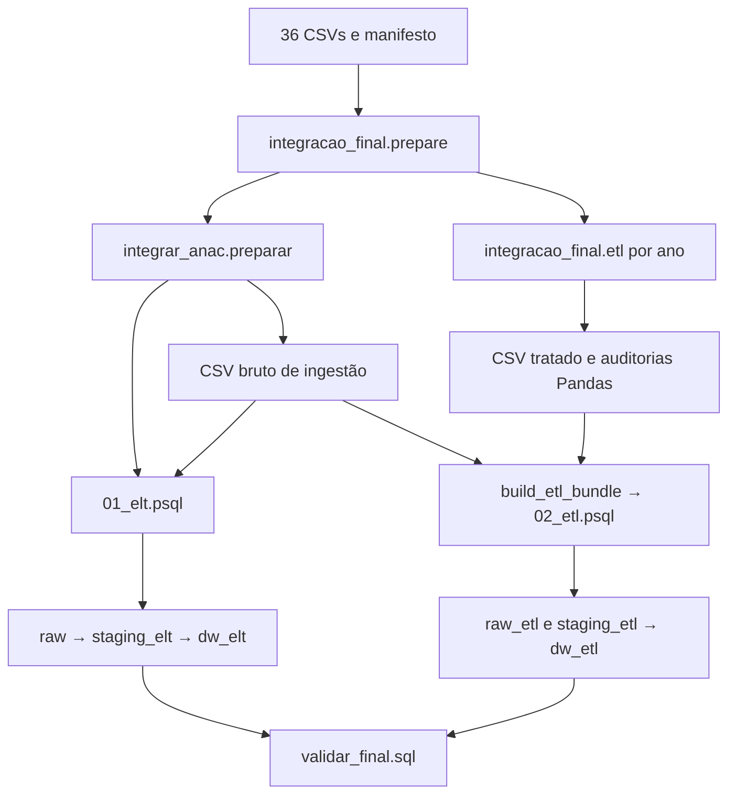

# Guia completo de estudo — VRA/ANAC 2019–2021

Este guia acompanha uma ocorrência desde o CSV até os dois Data Warehouses. A instalação e a carga estão no guia de reprodução. As consultas para a exposição estão no guia de demonstração. [Reprodução](REPRODUCAO_MULTIPLATAFORMA.md) · [Demonstração](GUIA_DEMONSTRACAO_PRATICA.md)

O roteiro de apresentação é um material interno da equipe, destinado à preparação da exposição oral, e não faz parte da entrega pública do repositório.

## 1. O problema e o desenho da solução

VRA significa **Voo Regular Ativo**. A base pública da ANAC traz situação e horários previstos e realizados de etapas de voo, com publicação mensal. Uma etapa liga uma origem a um destino e pode integrar uma operação com várias etapas. Uma linha na fato representa uma ocorrência elegível dessa fonte, inclusive quando a situação informada é cancelamento. Ela não mede passageiros nem equivale necessariamente a uma decolagem realizada. [Metadados oficiais da ANAC](https://www.anac.gov.br/acesso-a-informacao/dados-abertos/areas-de-atuacao/voos-e-operacoes-aereas/voo-regular-ativo-vra/62-voo-regular-ativo-vra)

O recorte contém 36 CSVs de 2019 a 2021. Integrar significa transformar esses arquivos em um conjunto coerente e rastreável, com tipos, campos, critérios de elegibilidade e medidas comuns. Veja três decisões que mudam uma análise: preservar `0035` como texto, distinguir horário desconhecido de atraso zero e contar cancelamentos por situação informada. Sem regras compartilhadas, duas consultas de mesmo nome poderiam contar coisas diferentes.

**ETL** é extrair, transformar e carregar. O Python lê a fonte, o Pandas trata o conjunto e o PostgreSQL recebe o resultado para montar a estrela. A cópia RAW no banco também é carregada, para auditoria. **ELT** é extrair, carregar e transformar. O banco recebe primeiro os valores brutos e o SQL faz a deduplicação, as conversões e a classificação. Ambos usam PostgreSQL para persistência e para a carga dimensional. O ponto de distinção é onde são produzidos os registros tratados.

O contrato pede duas implementações para que a equipe possa verificar se decisões equivalentes produzem o mesmo resultado em tecnologias diferentes. Por isso existem dois DWs, nos schemas `dw_etl` e `dw_elt` do mesmo banco. Um **schema** é um espaço de nomes. Um **Data Warehouse** é uma base organizada para análise. A mesma ocorrência elegível deve aparecer uma vez em cada DW. Use um DW para indicadores e os dois para validação. Somar os DWs dobraria a população.

A estrela separa os eventos, na fato, das entidades e categorias que dão contexto, nas dimensões. Para contar etapas por companhia e mês, filtre ou agrupe a fato usando as dimensões de companhia e tempo. O mesmo modelo pode responder sobre origem, destino, situação, tipo de linha e equipamento.

Python organiza arquivos, manifesta hashes e gera os bundles. Pandas trabalha com dados tabulares e NumPy é usado em operações de máscaras no tratamento. SQL e PL/pgSQL realizam conversões, consultas, validações e carga no PostgreSQL. `psql` interpreta `\copy` e outros metacomandos de cliente. SQLAlchemy, Psycopg e python-dotenv dão suporte às cargas Python individuais. Jupyter ou Colab servem à exploração e ao registro das entregas individuais. `unittest` cobre ingestão, geração, recursos e integração. Git preserva autoria e histórico. [README](../README.md) · [Contrato v1.1](Contrato_Tratamento_VRA_ANAC_2019_2021_ATUALIZADO.pdf)

### O que o contrato fixa

O PDF v1.1 é a especificação comum das duplas. Ele define o recorte mensal, os 20 campos originais e seu mapeamento, a ordem de deduplicação, os cinco atributos obrigatórios, as conversões, a proveniência, o significado das medidas, a granularidade da estrela e as conciliações de aceitação. Mudanças de regra são decisões do grupo. As duas implementações podem usar tecnologias diferentes, desde que preservem o significado e o resultado.

## 2. Como as chamadas se conectam

### Entrada e preparação compartilhadas

`baixar_vra.py` usa o manifesto para verificar tamanho e SHA-256. Em `integrar_anac.preparar()` e em `integracao_final.etl()`, os arquivos são ordenados e conferidos contra os 12 nomes mensais do ano. A leitura usa `csv.reader`, separador ponto e vírgula e `utf-8-sig`, que lida com BOM. O leitor recupera registros com campos entre aspas e quebras de linha internas. O cabeçalho e a largura das linhas são verificados. O hash antes e depois da leitura detecta mudança no arquivo durante o processamento. Não confunda essa verificação com o confronto contra o hash oficial, feito pelo downloader.

`ano_origem` vem do conjunto processado. `arquivo_origem` guarda o nome do CSV. `linha_origem` é a posição lógica do registro, contando o cabeçalho como 1. Um campo com quebra de linha pode ocupar mais de uma linha física no editor. `id_raw` é atribuído na sequência do ano e pode repetir em outro ano. O par `(ano_origem,id_raw)` identifica a ocorrência durante a integração.

### ETL integrado, passo a passo

1. `integracao_final.prepare()` chama `etl(ano, diretório, saída)` três vezes. `etl()` recria a leitura a partir dos originais e forma DataFrames com os valores textuais e a proveniência. A deduplicação vem de `raw.duplicated(ORIGINAIS, keep='first')`. Uma junção pelos 20 campos acrescenta à auditoria o arquivo e a linha da representante.
2. Sobre as representantes, `padronizar_textos()` renomeia, remove espaços externos e converte campos selecionados para maiúsculas. `converter_tipos()` chama os conversores seguros de horário, referência e assentos. `motivos_obrigatorios()` reúne motivos de rejeição e `auditar_opcionais()` registra valores inválidos e referência de outro ano. `calcular_metricas()` calcula as medidas das linhas elegíveis. Essas funções estão em `etl_vra_anac_2021.py`. A interface integrada reaproveita o núcleo Pandas já implementado e controla ano, entrada, deduplicação, saídas e carga de maneira uniforme, sem chamar o `run_etl()` individual.
3. `etl()` exporta tratados, rejeições, excedentes, anomalias e diagnósticos em `.local/final/etl/ANO/`. `export_csv()` e `write_csv_rows()` preservam a distinção entre nulo SQL e textos literais na importação. O resumo e o inventário ficam em JSON.
4. `build_etl_bundle()` usa os CSVs tratados e de auditoria do Pandas e os CSVs brutos de ingestão em `elt/raw_ANO.csv`. O prefixo da pasta indica onde o bruto foi preparado. O bundle ETL usa esse bruto para criar a própria RAW e prescinde das tabelas e dos resultados tratados do ELT. `treated_ddl()` define os tipos de staging. `\copy` carrega as tabelas anuais. `UNION ALL` consolida as saídas, mantendo multiplicidade. `dimension_sql('etl')` e `load_sql('etl')` carregam a estrela com as medidas calculadas pelo Pandas.
5. `validate()` repete a carga dimensional e chama `compare()`. `evidencias_final.evidence()` e `auditar_contrato_final.audit()` podem adicionar exportações e diagnósticos. A auditoria comprova separadamente o que o dado bruto continha, o que foi excluído da camada analítica e por quê.

| Fluxo | O que observar na execução anual |
|---|---|
| **ETL 2019** | `etl(2019,...)` lê os 12 `VRA_2019_MM.csv` e permite referência ISO. Gera os CSVs em `etl/2019/` abaixo da saída. `02_etl.psql` carrega `raw_etl.voos_2019`, a staging anual de 2019 e os fatos de 2019 na estrela compartilhada do ETL. O comparador usa a faixa de ocorrências de 2019. |
| **ETL 2020** | `etl(2020,...)` usa as mesmas regras e a referência ISO, inventário e numeração próprios, exportando em `etl/2020/`. O bundle carrega `raw_etl.voos_2020` e a staging anual correspondente. A classificação e as FKs finais são conferidas no recorte 2020. A carga individual documentada em `etl_vra_anac_2020.py` é um procedimento próprio, com configuração experimental. |
| **ETL 2021** | `etl(2021,...)` aceita referência ISO e `DD/MM/AAAA 00:00:00`. Preserva `Codeshare` no bruto e nas auditorias brutas quando disponível. Exporta em `etl/2021/` e carrega `raw_etl.voos_2021` e a staging de 2021 antes da carga e comparação final. |

### ELT integrado, passo a passo

1. `integrar_anac.preparar()` escreve o CSV bruto de ingestão com os 20 campos preservados, coluna de extensão quando aplicável e proveniência. Gera comandos `COPY` via `\copy` para as tabelas anuais `raw.voos_ANO`. O bundle consolida o inventário de ocorrências em `raw.ocorrencias`.
2. Para 2019 e 2020, a função renderiza `elt_2019_2020.sql` com `__SCHEMA_ELT__`, `__ANO__`, `__TABELA_ORIGEM__`, `__SUFIXO_ANUAL__` e `__COLUNA_ID_RAW__`. A parametrização mantém uma única implementação de regras comuns e distingue o ano nos nomes e nas verificações. Para 2021, a função adapta `elt_2021.sql`, que já contém seus conversores e seu layout próprios. `integracao_final.prepare()` faz o remapeamento para `staging_elt` e `dw_elt`, gera `01_elt.psql` e ajusta os arquivos do roteiro manual.
3. No banco, a tabela anual classificada calcula `ROW_NUMBER()` e `FIRST_VALUE()` sobre partições dos 20 campos brutos, com ordenação pela origem. Excedentes ficam na auditoria. As representantes passam por `limpar_texto()`, `datahora_segura()`, `data_segura()` e `inteiro_seguro()`. A tabela avaliada enumera motivos obrigatórios. As auditorias conservam dados de origem, e a tabela tratada recebe medidas, flags e opcionais nulos conforme as regras do ano.
4. A staging consolida os anos com `UNION ALL`. A estrela é criada pelo DDL adaptado. `dimension_sql('elt')` prepara cadastros e o snapshot, e `load_sql('elt')` resolve chaves e insere fatos. A carga e as validações verificam cardinalidade, conteúdo, chaves e conciliação. A comparação por ano usa a RAW e os resultados independentes dos dois fluxos.

| Fluxo | Operação anual dentro do PostgreSQL |
|---|---|
| **ELT 2019** | `raw.voos_2019` alimenta o SQL gerado em `03_transformar_2019.sql`. Os intermediários e auditorias recebem sufixo `_2019`. A referência válida com ano diferente recebe motivo de 2019. A consolidação e a carga levam os elegíveis de 2019 a `dw_elt.fato_voo`. |
| **ELT 2020** | `raw.voos_2020` alimenta `04_transformar_2020.sql`. O mesmo template recebe ano, tabela e sufixo de 2020 e conserva o filtro de referência ISO. O resultado de 2020 percorre a mesma consolidação, carga e comparação. |
| **ELT 2021** | `raw.voos_2021` alimenta `04b_transformar_2021.sql`. A função de referência reconhece os dois formatos observados. `Codeshare` permanece no bruto, fora da chave de deduplicação. A staging e os fatos de 2021 são conferidos junto aos demais, com comparação separada por ano. |

O roteiro completo e os significados dos arquivos gerados estão na [integração final](INTEGRACAO_FINAL.md). A equivalência byte a byte obtida na parametrização está nas [decisões técnicas](DECISOES_TECNICAS.md).

## 3. Modelo dimensional e rastreabilidade

A granularidade é **uma ocorrência de etapa de voo elegível**, após deduplicação e rejeições. `id_voo` é a chave substituta local da fato. A carga usa unicidade por `(ano_origem,id_raw)` e por `(ano_origem,arquivo_origem,linha_origem)`. A mesma identificação comercial de voo pode aparecer várias vezes. `quantidade_voos` vale 1 para cada fato.

| Dimensão | Chave natural | Chave de junção | Uso |
|---|---|---|---|
| `dim_tempo` | `data` | `id_tempo`, derivado como AAAAMMDD | Dois papéis, data prevista de partida e de chegada |
| `dim_companhia_aerea` | `companhia_icao` | `id_companhia` | Companhia e nome descritivo |
| `dim_aeroporto` | `aeroporto_icao` | `id_aeroporto` | Dois papéis, origem e destino |
| `dim_situacao_voo` | `situacao_voo` | `id_situacao` | Situação da fonte. FK opcional. |
| `dim_justificativa` | `justificativa` | `id_justificativa` | Motivo informado. Usa chave 0 para desconhecido. |
| `dim_tipo_linha` | `tipo_linha` | `id_tipo_linha` | Categoria da linha. FK opcional. |
| `dim_equipamento` | `modelo_equipamento` | `id_equipamento` | Modelo informado. Usa chave 0 para desconhecido. |

Chave natural é o valor que identifica a entidade na fonte. A substituta é a chave usada na estrela. Companhias de mesmo código podem receber IDs diferentes nos dois DWs. O SQL de comparação resolve IDs para atributos naturais e descritivos. Há nove relações dimensionais por fato, pois aeroporto e tempo têm dois papéis cada, além da FK composta para a tratada.

`02_dimensoes.sql` prepara os aeroportos, variantes e correções documentadas. O complemento `02_resolver_descricoes_final.sql` escolhe a última descrição não nula segundo ano, arquivo, ordinal e papel, depois das resoluções. É um snapshot tipo 1. A dimensão guarda a descrição selecionada, e a staging preserva as variantes e a origem da decisão. `03_carga_dw.sql` usa chaves naturais para resolver as FKs e conflitos de inserção na reexecução. Testar a repetição das inserções sobre o mesmo conjunto é diferente de rodar toda a instalação novamente. Em particular, o bundle de instalação cria schemas e espera destino novo.

Para rastrear uma ocorrência 2021, parta de `dw_etl.fato_voo`, junte à `staging_etl.vra_tratada` e a `raw_etl.ocorrencias` por `(ano_origem,id_raw)`, e termine em `raw_etl.voos_2021`. Use do bruto o nome do arquivo e o ordinal para localizar o registro no CSV original. Para ELT, faça a mesma travessia dentro de `dw_elt`, `staging_elt` e `raw`. Mostrar uma amostra prova o percurso da amostra. A validação integral verifica todos os vínculos do recorte. [Modelo dimensional](MODELO_DIMENSIONAL_FINAL.md) · [SQL de rastreabilidade](../sql/comparacao/rastreabilidade.sql)

## 4. Qualidade, casos de borda e como verificar

| Regra | Exemplo e resultado | Onde estudar |
|---|---|---|
| Deduplicação exata | Duas ocorrências do mesmo ano iguais nos 20 valores brutos deixam a primeira como representante. O excedente aponta para o arquivo e linha preservados. `Codeshare` e metadados ficam fora da chave. | `etl()`, templates SQL e `validar_ano()` |
| Igualdade só após padronizar | ` AZU ` e `AZU` podem coincidir depois da limpeza. O diagnóstico aponta o grupo. A igualdade após limpeza por si só não elimina uma ocorrência. | `duplicate_stats()` e `audit()` |
| Rejeição obrigatória | Companhia ICAO, origem, destino e as duas datas previstas são obrigatórios. Uma prevista vazia gera motivo `AUSENTE`, uma data preenchida e inviável gera `INVALIDA`. A mesma ocorrência pode reunir vários motivos. | `motivos_obrigatorios()` e tabelas anuais avaliadas |
| Ordem da classificação | Uma cópia exata inválida entra como excedente se vier depois da representante. A representante é avaliada e pode ser rejeitada. O diagnóstico de interseção informa esse caso sem contar a mesma ocorrência duas vezes na conciliação. | `exact_duplicate_stats()`, auditoria SQL e testes |
| Anomalia e nulo | Assentos `2147483648` excedem o limite de inteiro suportado. O tratado mantém `NULL` e a auditoria conserva campo e valor original. Um horário real vazio é desconhecido e não ganha multa, zero ou categoria de cancelamento. | `assentos_seguros()`, `auditar_opcionais()`, conversores SQL |
| Data e referência | `31/02` falha na verificação de calendário. Um previsto inválido rejeita, um opcional inválido gera anomalia. Uma referência válida fora do ano pode ser auditada e mantida. `ano_origem` identifica a fonte, e a data operacional pode cair em outro ano. | Conversores Python e SQL, `06_casos_limite.sql` e diagnósticos |
| Atraso e antecipação | Se a partida prevista era 10h e a real foi 9h45, diferença = −15 min e atraso = 0. Se a real for desconhecida, ambos são nulos. Uma diferença absoluta maior que 1.440 min aciona flag. A flag por si só não exclui a ocorrência. | `calcular_metricas()`, templates e restrições |
| Integridade | FKs exigem membros válidos. Datas previstas e origem são obrigatórias onde a carga exige. O pipeline concilia brutos = excedentes + rejeições + tratados, compara tratados × fatos e confere métricas. | DDL, `04_validar.sql`, `08_restricoes.sql` e comparador |
| Comparação integral | `validar_ano()` usa intervalos de até 25.000 IDs, `FULL JOIN` e `IS DISTINCT FROM`. Para anomalias usa `EXCEPT ALL` nos dois sentidos, mantendo multiplicidade. A fato é comparada com dimensões resolvidas, e as diferenças esperadas de IDs locais e metadados técnicos são tratadas pelo comparador. | `validar_final.sql` |

### Números que podemos defender

| Ano | Brutos por fluxo | Excedentes | Rejeitados | Fatos por DW | Divergências de conteúdo |
|---|---:|---:|---:|---:|---:|
| 2019 | 983.414 | 470 | 18 | 982.926 | 0 |
| 2020 | 483.545 | 124 | 1.512 | 481.909 | 0 |
| 2021 | 632.148 | 0 | 25.511 | 606.637 | 0 |
| Total | 2.099.107 | 594 | 27.041 | 2.071.472 | 0 |

A tabela é **histórica**, da execução com os CSVs reais. A validação recente no Fedora passou **11 testes**, incluindo os dois PostgreSQL single-user. Os seis fluxos foram executados com fixtures, e uma conferência adicional contou **3, 3 e 4 fatos por DW** por ano. O teste integrado verifica carga independente do ETL, roteiro manual, repetição dimensional e detecção de uma divergência provocada. O teste de template confirma hashes do SQL anual, mas é a integração PostgreSQL que comprova a execução das fixtures. O JSON antigo de testes é evidência de uma rodada anterior. [Resultados reais](../relatorio/STATUS_FINAL_PROJETO.md) · [Validação sintética](INTEGRACAO_FINAL.md#validação-funcional-com-fixtures)

### Pontos que merecem cuidado na defesa

- **A auditoria preserva a referência bruta.** Nos dois fluxos, uma referência válida de outro ano, como `01/01/2020 00:00:00` num CSV de 2021, fica como texto original na anomalia `REFERENCIA_FORA_DE_2021` e como `DATE '2020-01-01'` na fato. A regressão também cobre o formato ISO e o formato brasileiro sem horário, que é inválido pela regra adotada. [Decisão técnica](DECISOES_TECNICAS.md#auditoria-da-referência-fora-do-ano-em-2021) · [Teste integrado](../tests/test_integracao_final.py)
- O ELT consolida seus indicadores de qualidade em `staging_elt.resumo_qualidade`. Os resumos do Pandas ficam nos JSONs anuais. As consultas de demonstração leem as estrelas diretamente. [Análises](../sql/comparacao/analises_finais.sql) · [Orquestração](../scripts/integracao_final.py)
- **Ambientes e definições.** Fedora e single-user foram testados. Serviço TCP, download oficial por HTTPS e execução em Windows/macOS têm os limites indicados no guia. O atraso positivo é a definição da consulta do projeto. Fuso e interpretação operacional de referência têm limites documentais. [Portabilidade](../relatorio/PORTABILIDADE.md) · [Contrato v1.1](Contrato_Tratamento_VRA_ANAC_2019_2021_ATUALIZADO.pdf)

## 5. Mapa dos arquivos

O mapa cobre os **79 arquivos rastreados presentes** na árvore local antes da criação dos três materiais. Arquivos já marcados para exclusão não entram como componentes ativos. Um notebook ou evidência histórica ainda presente pode documentar uma entrega individual sem ser entrada da integração final. Nas tabelas abaixo, a última coluna indica quem usa o arquivo e, quando verificável, o efeito da ausência.

### Raiz, entradas e documentação

| Caminho | Papel e funcionamento | Uso e efeito da ausência |
|---|---|---|
| `README.md` | Entrada da reprodução e visão dos fluxos. | Encaminha avaliação, configuração e guias. |
| `requirements.txt` | Faixas dos pacotes Python para tratamento e cargas individuais. | Instalação em ambiente limpo. Sem ele perde-se a especificação do ambiente. |
| `.env.example` | Modelo sem senha para conexão dos ETLs individuais. | Usuário cria seu próprio `.env`. A CLI por `psql` usa o ambiente e libpq. |
| `.gitignore` | Mantém dados, credenciais, ambientes e saídas locais fora do rastreamento automático. | Git. A ausência aumenta o risco de adicionar saídas ou segredos locais. |
| `dados/manifesto_vra.json` | Inventário dos 36 arquivos, URLs, tamanhos e hashes. | Entrada de `baixar_vra.py` e do teste do manifesto. |
| `documentacao/Contrato_Tratamento_VRA_ANAC_2019_2021_ATUALIZADO.pdf` | Especificação e critérios v1.1. | Base acadêmica das regras. O pipeline não interpreta o PDF. |
| `documentacao/DECISOES_TECNICAS.md` | Explica o template anual parametrizado e como a equivalência foi demonstrada. | Leitura técnica ligada ao README e ao teste do template. |
| `documentacao/INTEGRACAO_FINAL.md` | Arquitetura, execução isolada, ordem manual e auditoria. | Leitores e `validar_guia.py`, que confere a sequência manual. |
| `documentacao/MATRIZ_CONFORMIDADE_FINAL.md` | Mapeia requisitos, evidências e limitações. | Apresentação e avaliação. A revisão local deve ser considerada na publicação. |
| `documentacao/MODELO_DIMENSIONAL_FINAL.md` | Explica granularidade, chaves, medidas e relacionamentos. | Estudo do DDL e apresentação. |
| `documentacao/REPRODUCAO_MULTIPLATAFORMA.md` | Instalação, serviço PostgreSQL, carga e limites por plataforma. | Caminho principal do README e entrada do validador. |
| `documentacao/esquema_estrela.png` | Diagrama visual da estrela. | Apresentação. A imagem não cria tabelas. |
| `documentacao/resolucoes_aeroportos_2020.csv` | Mapeia descrições de SBEG e SWHP, com fonte e justificativa. | Entrada padrão de `etl_vra_anac_2020.py` e `dim_aeroporto.py`. A carga integrada usa resoluções já incorporadas no SQL. |

### Scripts

| Caminho | Papel e dependências | Uso e efeito da ausência |
|---|---|---|
| `scripts/integracao_final.py` | Orquestra preparação, Pandas, bundles, execução e comparação. Usa `integrar_anac`, conversores 2021, SQLs, executor e verificação de espaço. | Ponto de entrada final e alvo dos testes. Sua ausência impede gerar e operar a integração final. |
| `scripts/integrar_anac.py` | Ingestão canônica, renderização dos templates, DDL e etapas. O subcomando `apply` pertence ao roteiro legado. | `integracao_final`, validadores, testes e utilitários de hash. Sem ele perde-se a preparação compartilhada. |
| `scripts/etl_vra_anac_2019.py` | ETL individual com leitura, transformação, estrela experimental e carga opcional. | Notebook 2019 e construtor reutilizado no ETL individual 2020. A integração final usa o núcleo 2021. |
| `scripts/etl_vra_anac_2020.py` | ETL individual. Lê resoluções aeroportuárias, chama o construtor dimensional anterior e pode carregar schema experimental. | Notebook 2020, `comparar_2020` e `dim_aeroporto`. |
| `scripts/etl_vra_anac_2021.py` | ETL individual e funções Pandas reutilizadas para padronização, conversão, motivos, anomalias e métricas. | Notebook 2021, ETL integrado anual e auditoria final. Remover interrompe o tratamento integrado. |
| `scripts/baixar_vra.py` | Obtém ou verifica arquivos e publica a cópia só após conferir tamanho e hash. | README, reprodução e teste com arquivos locais. |
| `scripts/espaco_disco.py` | Estima e protege a reserva local com `shutil.disk_usage`. | Preparação, carga isolada, auditoria e backup. |
| `scripts/testar_integracao_isolada.py` | `executar()` chama `postgres --single` e interpreta erros. A CLI exercita o bundle canônico. | Importado pela execução e auditorias finais e pelos testes. |
| `scripts/auditar_contrato_final.py` | Compara os diagnósticos Pandas e SQL por ano, incluindo interseção, repetições e partidas fora do ano. | Teste integrado e geração das evidências contratuais. |
| `scripts/evidencias_final.py` | Consulta DWs, exporta indicadores, compara hashes analíticos e reexporta RAW para confronto byte a byte. | Teste integrado e regeneração de evidências. |
| `scripts/comparar_2020.py` | Compara as tabelas dos schemas experimentais de 2020 por origem usando SQLAlchemy. | Uso individual. Sua ausência retira esse comparador, que é distinto do final. |
| `scripts/dim_aeroporto.py` | Lê tratados e resoluções, constrói cadastro de aeroporto e preserva IDs de um registro existente quando informado. | Ferramenta individual de 2020. A dimensão integrada é gerada em SQL. |
| `scripts/backup_cluster_isolado.py` | Arquiva cluster offline, extrai uma cópia e verifica a restauração com SQL configurável. | Roteiro de recuperação. A carga final não exige executar esse utilitário. |
| `scripts/validar_guia.py` | Confere guias atuais, comandos, manifestos, 12 etapas e metacomandos. | Revisão documental e do bundle. Não conecta ao banco. |

### SQLs versionados

| Caminho | Papel e dependências | Uso e efeito da ausência |
|---|---|---|
| `sql/transformacoes/elt_2019_2020.sql` | Marcadores anuais e transformação antes da consolidação. | `preparar()` renderiza 2019 e 2020. A ausência interrompe os dois. |
| `sql/transformacoes/elt_2021.sql` | Conversão própria da referência, estágios e auditorias SQL do ano. | `preparar()` adapta 2021. A ausência interrompe esse ano. |
| `sql/database/10_criacao_dw.sql` | DDL base das oito tabelas e relações dimensionais. | Gerado e adaptado para os dois DWs. |
| `sql/integracao/02_dimensoes.sql` | Views e resoluções para derivar cadastros dimensionais. | `dimension_sql()` injeta o complemento final e ajusta o cadastro de aeroporto. |
| `sql/integracao/02_resolver_descricoes_final.sql` | Snapshot e variantes descritivas com proveniência. | Inserido por `dimension_sql()`. Alimenta companhia e aeroporto na estrela final. |
| `sql/integracao/03_carga_dw.sql` | Insere membros e fatos com junções, verificações e tratamento de conflitos. | `load_sql()` remapeia para cada DW e usa as métricas próprias. |
| `sql/integracao/04_validar.sql` | Asserções de conservação, elegibilidade, origem, métricas e relações. | Bundle ELT, roteiro de validação e teste canônico. |
| `sql/integracao/05_analises.sql` | Template canônico com SELECTs por ano, companhia, aeroporto, mês e qualidade. | O gerador adapta os schemas nas etapas manuais e na execução isolada. |
| `sql/comparacao/analises_finais.sql` | Ocorrências, atrasos, antecipações, situações, companhias e aeroportos por fluxo. | Executar diretamente com os dois DWs carregados. |
| `sql/integracao/06_casos_limite.sql` | Exercita funções SQL com calendário inválido, horários fora do intervalo, assentos e valores textuais. | Etapa de validação canônica/ELT. |
| `sql/integracao/07_diagnosticos.sql` | Diagnósticos de duplicatas, rejeições, horários e origem. | Etapa manual de diagnóstico. |
| `sql/integracao/08_restricoes.sql` | Obrigatoriedade e checks de proveniência, métricas e fato. | Bundle ELT e trecho adaptado de restrições da fato no bundle ETL. |
| `sql/comparacao/validar_final.sql` | Cria views e funções de comparação, depois confere dimensões e três anos. | `compare()`, execução por serviço e teste integrado. Necessário para a prova integral. |
| `sql/comparacao/rastreabilidade.sql` | SELECTs que seguem uma amostra de fatos 2021 até a RAW dos dois fluxos. | Demonstração e inspeção pontual. |
| `sql/comparacao/validar_restauracao.sql` | Asserções sobre RAW, fatos, dimensões e chaves em banco carregado. | Recuperação, teste integrado e conferência pós-carga. |

### Testes e notebooks

| Caminho | O que faz e o que usa | Papel |
|---|---|---|
| `tests/test_baixar_vra.py` | Usa `baixar_vra`, manifesto e auditoria de hashes. Testa fonte local e proteção do destino. | Sem ele perde-se a conferência automatizada da entrada. |
| `tests/test_espaco_disco.py` | Simula valores de disco ao redor do limite de segurança. | Validação do guardião de espaço sem alocação real. |
| `tests/test_ingestao.py` | Usa `preparar()` para validar meses, cabeçalho e preservação de valores e ordinais, além do formato de caminho Windows. | Ingestão sintética, independente do banco. |
| `tests/test_template_elt.py` | Gera etapas anuais e confere hashes de referência, origem, ano e marcadores. | Regressão da geração do SQL dos três anos. |
| `tests/test_integracao_final.py` | Usa `prepare()`, `isolated()`, auditoria, evidências e comparadores. Cria três clusters temporários. | Teste real de SQL e Pandas com fixtures, inclusive ETL independente e divergência proposital. |
| `tests/test_pipeline_postgresql.py` | Gera o bundle canônico 2019/2020, executa nos modos conjunto e manual e confere resultados após reexecução. | Regressão dos componentes canônicos reaproveitados. |
| `notebooks/elt/elt_2019.ipynb` | Apresenta ingestão de ZIP, carga bruta, SQL e conferências de 2019 no Colab. | Estudo individual. O gerador integrado não lê o notebook. |
| `notebooks/elt/elt_2020.ipynb` | Mostra estágio bruto e SQL individual de 2020, com exportação de evidências. | Demonstração da implementação individual. |
| `notebooks/elt/elt_2021.ipynb` | Mostra leitura das fontes de 2021, carga e SQL individual incluindo layout próprio. | Estudo individual e origem documentada do SQL adaptado. |
| `notebooks/etl/etl_2019.ipynb` | Chama o ETL individual 2019 e apresenta conferência de arquivos, métricas e tabelas. | Estudo do tratamento individual. |
| `notebooks/etl/etl_2020.ipynb` | Usa o script individual para tratamento, resolução de aeroportos, carga opcional e análise de cancelamentos. | Estudo e evidência experimental. Sua edição local integra a preparação da entrega. |
| `notebooks/etl/etl_vra_anac_2021.ipynb` | Chama o ETL individual 2021 e inspeciona resultados e auditorias. | O gerador final importa o script, e o notebook preserva o procedimento individual. |
| `notebooks/exploracao/exploracao-2019.ipynb` | Explora ZIP, campos vazios, duplicatas brutas e datas previstas. | Diagnóstico do dado e motivação do contrato. |
| `notebooks/exploracao/exploracao_2020.ipynb` | Explora ausências, duplicatas, layout e preservação dos arquivos. | Diagnóstico e comparação entre fontes anuais. |

### Relatórios

| Caminho | O que documenta | Uso |
|---|---|---|
| `relatorio/LIMPEZA_RESULTADOS.md` | Decisões de retenção e regeneração de exportações. | Entender por que o Git contém evidências compactas. |
| `relatorio/PORTABILIDADE.md` | Testes Fedora e limites de plataforma, conexão e download. | Delimitar o que está comprovado. |
| `relatorio/QUALIDADE_2019_2021.md` | Contagens, padrões e diagnósticos medidos no recorte real. | Explicar rejeições e duplicatas na defesa. |
| `relatorio/STATUS_FINAL_PROJETO.md` | Execução real, comparação, análise e recuperação. | Referência histórica dos números finais. |
| `relatorio/relatorio_elt_2020.md` | Implementação SQL individual, resultados e evidências. | Autoria e contexto de 2020. |
| `relatorio/relatorio_elt_2021.md` | Implementação SQL individual, peculiaridades de layout e resultados. | Autoria e contexto de 2021. |
| `relatorio/relatorio_etl_2019.md` | ETL individual, suas validações e limites históricos. | Autoria e estudo do ano. |
| `relatorio/relatorio_etl_2020.md` | ETL individual, resoluções, carga experimental e análises. | Uso acadêmico e trilha das decisões de 2020. |

### Evidências versionadas

São resultados compactos e registros de auditoria. Sua ausência reduz a capacidade de comprovar a execução anterior. `fontes_inalteradas.json` tem, além disso, consumo explícito por teste.

| Caminho | Conteúdo e uso |
|---|---|
| `resultados/validacoes/integracao_final/armazenamento.json` | Espaço medido antes e depois da consolidação e registro de retenção. |
| `resultados/validacoes/integracao_final/backup_isolado.json` | Hash e resultado da restauração física de referência. O arquivo grande de backup é local. |
| `resultados/validacoes/integracao_final/comparacao_analitica.json` | Igualdade de agregados e perfis. Complementa a comparação por registro. |
| `resultados/validacoes/integracao_final/comparacao_integral.json` | Contagens anuais, zero divergências, dimensões, FKs e metadados do SQL de comparação. |
| `resultados/validacoes/integracao_final/diagnosticos_contrato.json` | Resultado da conferência Pandas × SQL dos diagnósticos. |
| `resultados/validacoes/integracao_final/diagnosticos_contrato_sql.csv` | Grupos e linhas duplicadas, interseção com inválidos e partidas fora do ano por recorte. |
| `resultados/validacoes/integracao_final/fontes_inalteradas.json` | Hashes das fontes auditadas. O teste do downloader usa esse arquivo como referência independente do manifesto. |
| `resultados/validacoes/integracao_final/identidade_raw.json` | Confronto de hashes dos seis RAWs reexportados com os CSVs de ingestão. |
| `resultados/validacoes/integracao_final/layout_2021.json` | Inventário do layout observado em 2021. |
| `resultados/validacoes/integracao_final/qualidade.csv` | Resumo anual de RAW, tratados, rejeições, excedentes, nulos e atípicos. |
| `resultados/validacoes/integracao_final/recuperacao_cluster.json` | Registro da recuperação WAL e do reaproveitamento das cargas. |
| `resultados/validacoes/integracao_final/testes.json` | Registro de uma rodada anterior de testes sintéticos. A rodada de 11 está no guia final. |
| `resultados/validacoes/resumo_qualidade_elt_2020.csv` | Resumo individual SQL 2020. O ETL experimental pode usá-lo numa comparação preliminar se o inventário correspondente estiver disponível. |
| `resultados/validacoes/resumo_qualidade_elt_2021.csv` | Resumo individual SQL 2021, com diagnósticos de layout e qualidade. |
| `resultados/validacoes/resumo_qualidade_etl_2020.csv` | Indicadores da fase de tratamento individual 2020. |
| `resultados/validacoes/validacao_postgresql_etl_2020.json` | Evidência da carga experimental de 2020, distinta da conferência dos dois DWs finais. |

**Saídas geradas e arquivos locais.** Os originais e as saídas individuais ficam em `dados/brutos/` e `dados/processados/` ou nos destinos configurados. O bundle final contém `01_elt.psql`, `02_etl.psql`, manifesto e, sob `elt/manual/`, a sequência manual. `.local/` pode guardar clusters, logs e exportações. `backups/`, ambientes virtuais e `.env` são locais.

## 6. Ordem de estudo em cinco sessões

1. **Entender o problema.** Leiam README, contrato e modelo. Cada integrante deve conseguir dizer a granularidade, nomear as camadas e explicar por que a soma dos dois DWs estaria errada.
2. **Seguir um registro.** Abram `preparar()` e `etl()`. Anotem onde surgem os metadados, qual campo é bruto e como uma linha multilinha continua sendo uma ocorrência.
3. **Comparar tratamentos.** Abram os conversores Pandas e os templates. Escolham um caso de duplicata, um de rejeição e um de anomalia. Descrevam a tabela ou CSV de destino em cada fluxo.
4. **Montar e consultar a estrela.** Leiam o DDL, `dimension_sql()`, `load_sql()` e a consulta de rastreabilidade. Expliquem por que companhia e aeroporto podem ter IDs diferentes entre os DWs.
5. **Defender a prova.** Leiam o teste integrado, `validar_ano()` e os dois relatórios de resultados e portabilidade. Reajam a uma divergência simulada e indiquem ano, etapa e origem que vocês investigariam primeiro.
