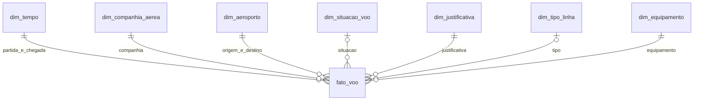

# Modelo dimensional dos dois fluxos

`dw_etl` e `dw_elt` têm o mesmo DDL, derivado de `sql/database/10_criacao_dw.sql`. Cada schema possui sua própria estrela e suas próprias chaves substitutas. O gerador adapta a unicidade global para `(ano_origem,id_raw)` e adiciona rastreabilidade e constraints. Não comparar IDs dimensionais entre schemas.

| Dimensão | Chave substituta | Chave natural | Papel |
|---|---|---|---|
| `dim_tempo` | `id_tempo` (AAAAMMDD) | `data` | Datas previstas de partida e chegada |
| `dim_companhia_aerea` | `id_companhia` | `companhia_icao` | Companhia e descrição do snapshot |
| `dim_aeroporto` | `id_aeroporto` | `aeroporto_icao` | Origem e destino na mesma dimensão |
| `dim_situacao_voo` | `id_situacao` | `situacao_voo` | Situação informada, sem confundir NULL com cancelamento |
| `dim_justificativa` | `id_justificativa` | `justificativa` | Chave 0 para DESCONHECIDO |
| `dim_tipo_linha` | `id_tipo_linha` | `tipo_linha` | Código original padronizado |
| `dim_equipamento` | `id_equipamento` | `modelo_equipamento` | Chave 0 para DESCONHECIDO |

A fato tem uma linha por ocorrência elegível de etapa de voo, `quantidade_voos=1`. `id_voo` é a chave substituta; `(ano_origem,id_raw)` e `(ano_origem,arquivo_origem,linha_origem)` são únicos. O número do voo é textual para preservar zeros. Código DI também permanece texto. Datas reais podem ser NULL; datas previstas são obrigatórias. O ano de origem identifica o conjunto CSV e pode divergir do ano operacional.

Medidas: diferença de partida/chegada em minutos (com sinal), atraso de partida/chegada (máximo entre diferença e zero, preservando NULL), flags de diferença absoluta superior a 1440 minutos e número de assentos opcional. A fato guarda timestamps previstos e reais, referência, situações da fonte e indicador de pipeline. O DW ETL recebe essas métricas do CSV Pandas; o DW ELT recebe as métricas SQL.

As descrições dimensionais usam snapshot tipo 1 da última ocorrência não nula observada, após as correções aeroportuárias canônicas. Os tratados e as auditorias preservam os nomes históricos. `snapshot_descricoes` permite localizar a origem da descrição selecionada; `variantes_dimensoes` permite inspecionar conflitos de nomes.

A fato referencia a tratada do próprio fluxo; esta referencia `raw_etl.ocorrencias` no ETL ou `raw.ocorrencias` no ELT. A tabela RAW anual permite recuperar todo o conteúdo bruto. Os 20 campos contratuais são preservados e a extensão `Codeshare` de 2021 permanece bruta. A comparação resolve todas as dimensões para chaves naturais e compara também os seus atributos descritivos.
